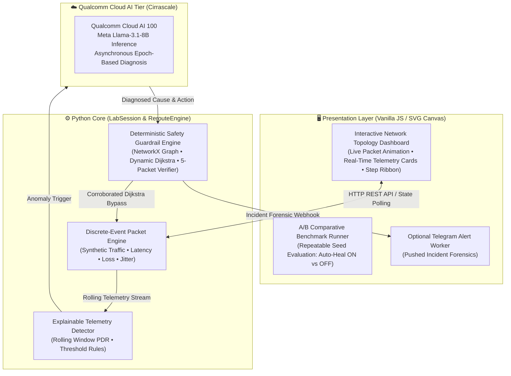
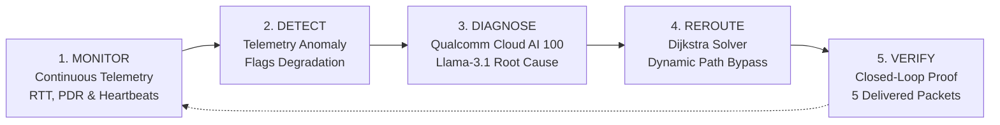

<div align="center">

# 🌐 NEXUS: AI-Assisted Self-Healing Network Simulator
### Closed-Loop Telemetry Anomaly Detection, Qualcomm Cloud AI Reasoning & Verified Dynamic Rerouting

[](https://aihub.qualcomm.com)
[-EA2839?style=for-the-badge)](https://aisuite.cirrascale.com)
[]()

**Team Setu** | *Bhoj Reddy Engineering College for Women, Hyderabad*  
**Infosys Ignite ENG NEXT 2026 Hack-AI-Thon**

[System Architecture](#-system-architecture) • [Self-Healing Lifecycle](#-the-closed-loop-self-healing-lifecycle) • [Demo Walkthrough](#-demo-walkthrough) • [Acknowledgements](#-acknowledgements--upstream-credit)

---

</div>

## 📌 Executive Summary

**NEXUS** is an autonomous, closed-loop network simulation and self-healing platform built for **Problem Statement NC-04 (Self-Healing Network Simulator)**. It combines a discrete-event packet simulation engine with hardware-accelerated **Qualcomm Cloud AI 100** inference (running Meta Llama-3.1-8B via Cirrascale) to continuously monitor network health, detect link degradation, diagnose root causes from observed telemetry, dynamically reroute traffic, and strictly verify recovery before declaring success.

### Key Capabilities
1. **Early Telemetry Anomaly Detection:** Monitors rolling packet delivery rate (PDR), latency trends, per-link queue utilization, and heartbeat probes to detect emerging congestion before catastrophic link collapse.
2. **Qualcomm Cloud AI 100 Diagnosis:** Submits structured telemetry snapshots to **Llama-3.1-8B on Qualcomm Cloud AI 100** (Cirrascale) to infer the root cause (e.g., `LINK_FAILURE`, `HIGH_CONGESTION`) and recommend an allowed remediation action (`REROUTE_TRAFFIC`, `BYPASS_COMPONENT`).
3. **Deterministic Safety Guardrails:** Network topology updates are strictly bounded by NetworkX graph algorithms. AI suggestions are corroborated against observed telemetry; uncorroborated responses or network timeouts fall back safely to deterministic rules.
4. **Closed-Loop Verification:** Recovery is never assumed. NEXUS requires **5 consecutive packets** to be successfully delivered on the replacement route within target SLO latency before transitioning the incident to `Recovered`. If no alternative path exists, the system honestly reports an `Unresolved` state.
5. **Instant Push Notification:** An asynchronous Telegram alert worker notifies on-call network engineers with complete incident forensics.

---

## 🏛️ System Architecture



---

## 🔄 The Closed-Loop Self-Healing Lifecycle



1. **Monitor (Healthy):** Packets traverse the primary forwarding corridor (`Client ➔ R1 ➔ R2 ➔ R4 ➔ R6 ➔ Server`). Telemetry is aggregated across rolling windows.
2. **Detect:** The detector flags link loss, persistent latency increases, or missed heartbeats (e.g., fault injected on `R2-R4`).
3. **Diagnose:** Telemetry context is formatted and dispatched asynchronously to **Qualcomm Cloud AI 100** running Llama-3.1-8B. The model diagnoses the failure mode. The backend corroborates the diagnosis against measured link telemetry to prevent unverified attributions.
4. **Reroute:** The healing manager applies dynamic Dijkstra graph reweighting, identifying the lowest-cost alternate bypass (`Client ➔ R1 ➔ R3 ➔ R5 ➔ R6 ➔ Server`) and updating forwarding tables.
5. **Verify:** The engine tracks packets on the bypass corridor. Only after **5 consecutive packets** are delivered within SLO targets is the incident certified as resolved.

---

## 🎬 Demo Walkthrough

### 1. Baseline Operation
* Launch the simulator (`http://localhost:8000`).
* Verify that the header displays the active provider badge: `● Qualcomm AI 100`.
* Observe synthetic traffic flowing along the primary corridor `R1 ➔ R2 ➔ R4 ➔ R6` with latency well below the $30\text{ ms}$ SLO target.

### 2. Inject Fault & Observe Recovery
* Click **`⚡ Inject Fault`** (e.g., *Sudden Link Failure on R2-R4* or *Preventive Congestion*).
* The link status turns degraded/failed.
* Telemetry triggers asynchronous diagnosis with Qualcomm Cloud AI 100.
* Watch the status ribbon advance: `Detected ➔ Diagnosing ➔ Rerouting ➔ Verifying ➔ Recovered`.
* The visual topology highlights the new bypass route (`R1 ➔ R3 ➔ R5 ➔ R6`).
* After 5 verification packets pass successfully, the impact card updates with observed packet counts, delivery restoration status, and SLA compliance.

### 3. A/B Repeatable Benchmark
* Switch to the **Compare** tab to execute a controlled run comparing **Auto-Heal ON** versus **Auto-Heal OFF** using identical workloads and random seeds.

---

## 🔬 Hardware Exploration: Edge Silicon Feasibility

In addition to our cloud deployment on Qualcomm Cloud AI 100, we explored the feasibility of edge hardware execution using the **Qualcomm AI Hub SDK**:

* **Target Device:** Physical Snapdragon X Elite Compute Reference Device (CRD).
* **Target Runtime:** Qualcomm Neural Network (QNN) runtime targeting the Hexagon Tensor Processor (HTP).
* **Profiling Benchmark:** A compiled vision backbone model achieved a hardware execution latency of **0.64 ms** (641 µs) with 100% NPU operator delegation.
* **Scope Note:** This benchmark serves as a separate hardware exploration to demonstrate Qualcomm NPU line-rate inference capabilities; live telemetry diagnosis in the current NEXUS simulator is served via the Qualcomm Cloud AI 100 API.
* **Verified Qualcomm Workbench Job:** [Job jglw1r28p](https://workbench.aihub.qualcomm.com/jobs/jglw1r28p/)

---

## 🛠️ Tech Stack

* **Simulation Core:** Python 3.12, NetworkX (topology graphs), discrete-event packet scheduler
* **Backend Serving:** Python standard library HTTP server (`http.server`) with REST endpoint routing
* **Cognitive Diagnosis:** Qualcomm Cloud AI 100 (Cirrascale AI Suite API v2), Meta Llama-3.1-8B
* **Frontend:** Vanilla JavaScript (ES6+), SVG Canvas rendering, CSS Grid & Flexbox
* **Verification & Testing:** Pytest, Node.js Playwright test scripts (`test_nexus_release.cjs`)
* **Alerting:** Python Telegram Bot API worker

---

## 👥 Team Information (Team Setu)

* **Institution:** Bhoj Reddy Engineering College for Women, Hyderabad  
* **Event:** Infosys Ignite ENG NEXT 2026 Hack-AI-Thon  
* **Track:** Problem Statement NC-04: Self-Healing Network Simulator  
* **Members:**
  * **Reya Doshi** (Team Lead)
  * **D. Swathi**
  * **Amula Pranathi**

---

## 🙏 Acknowledgements & Upstream Credit

NEXUS builds upon and extends the educational discrete-event packet simulation foundation of [NetAdapt](https://github.com/akashgoudsidduluri/adaptive-self-healing-network-routing) by Akash Goud Sidduluri. 

Our core contributions and additions for **Infosys Ignite Hack-AI-Thon NC-04** include:
1. Integration with **Qualcomm Cloud AI 100** (Cirrascale v2 API) running Llama-3.1-8B for asynchronous telemetry root-cause diagnosis.
2. A deterministic safety guardrail and corroboration pipeline preventing LLM hallucination in network routing.
3. Closed-loop 5-packet rolling delivery verification against explicit SLO latency targets.
4. Enhanced interactive SVG topology interface with dynamic fault injection, step ribbon, and A/B comparison runner.
5. Hardware feasibility profiling on Snapdragon X Elite NPU via Qualcomm AI Hub.
6. Automated Telegram alerting pipeline for on-call NOC engineers.

---

## 💻 Quick Start & Running Locally

### 1. Clone & Activate Environment
```bash
git clone https://github.com/Reya-Doshi/Nexus.git
cd Nexus
python -m venv .venv
.\.venv\Scripts\activate   # Windows
# source .venv/bin/activate # Linux / macOS
```

### 2. Install Dependencies
```bash
pip install -r python-tested-requirements.txt
```

### 3. Configure Qualcomm Cloud AI Credentials
Create a `.env` file in the project root:
```env
QUALCOMM_AI_ENDPOINT=https://aisuite.cirrascale.com/apis/v2
QUALCOMM_AI_KEY=your_qualcomm_api_key_here
QUALCOMM_AI_MODEL=Llama-3.1-8B

# Optional Telegram notifications
TELEGRAM_ENABLED=false
TELEGRAM_BOT_TOKEN=your_bot_token
TELEGRAM_CHAT_ID=your_chat_id
```
*(If credentials are not supplied or network connectivity is unavailable, the system automatically falls back to deterministic rule-based diagnosis).*

### 4. Launch Application
```bash
python -m netadapt.lab_server --port 8000
```
Open your browser at: **`http://localhost:8000/`**

### 5. Run Verification Tests
```bash
pytest netadapt/test_reroute.py -v
```

---

<div align="center">
<strong>Engineered by Team Setu for Infosys Ignite ENG NEXT 2026</strong>
</div>
