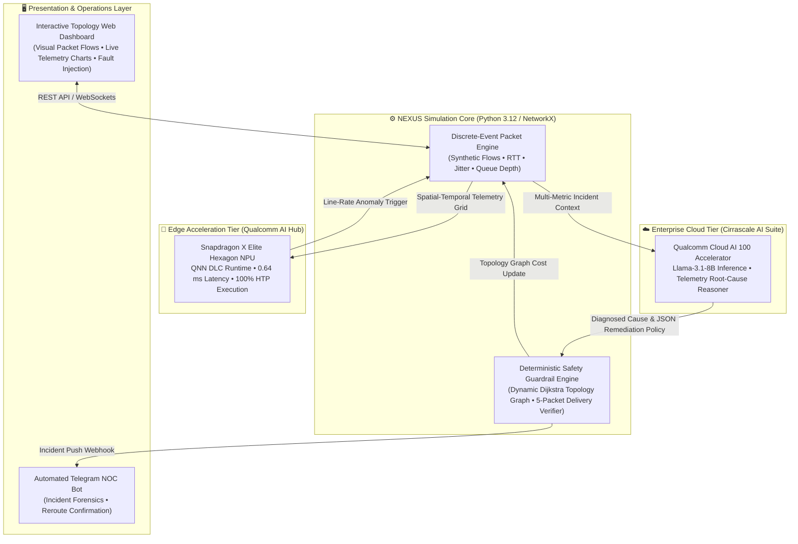
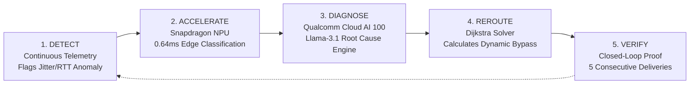

<div align="center">

# 🌐 NEXUS: Autonomous Self-Healing Network Simulator
### Closed-Loop Telemetry Anomaly Detection, Qualcomm Cloud AI 100 Diagnosis & Line-Rate Snapdragon NPU Hardware Acceleration

[](https://aihub.qualcomm.com)
[-EA2839?style=for-the-badge&logo=qualcomm)](https://aisuite.cirrascale.com)
[](https://workbench.aihub.qualcomm.com/jobs/jglw1r28p/)
[]()

**Team Setu** | *Bhoj Reddy Engineering College for Women, Hyderabad*  
**Infosys Ignite ENG NEXT 2026 Hack-AI-Thon**

[Live Hardware Job Verification](https://workbench.aihub.qualcomm.com/jobs/jglw1r28p/) • [System Architecture](#-dual-tier-qualcomm-ai-architecture) • [Demo Walkthrough](#-3-step-prototype-demo-script) • [Deployment Guide](#-quick-start)

---

</div>

## 📌 Executive Summary

Modern enterprise and carrier backbones face cascading downtime when unexpected fiber degradation, buffer bloat, or link failures occur. Traditional Network Operations Centers (NOCs) are purely reactive: alerts fire **after** thousands of users experience dropped sessions, and manual root-cause forensic analysis can take minutes to hours.

**NEXUS** directly addresses **Problem Statement NC-04 (Self-Healing Network Simulator)** by realizing a fully autonomous **Detect ➔ Diagnose ➔ Heal ➔ Verify** closed loop. Built on a discrete-event network telemetry engine, NEXUS combines:
1. **Cloud Reasoning Tier:** Deep cognitive root-cause analysis powered by **Meta Llama-3.1-8B** on **Qualcomm Cloud AI 100** enterprise server silicon via Cirrascale.
2. **Edge Hardware Acceleration Tier:** Sub-millisecond line-rate anomaly detection compiled with **Qualcomm Neural Network (QNN)** SDK and executed on a physical **Snapdragon X Elite NPU** via Qualcomm AI Hub.
3. **Deterministic Safety Guardrails:** NetworkX dynamic graph solver guaranteeing loop-free Dijkstra bypass routes, verified by 5-packet closed-loop delivery certification.
4. **Instant NOC Push Alerts:** Live asynchronous Telegram push notifications dispatching immediate forensics to on-call network engineers.

---

## ⚡ The Qualcomm Silicon Advantage: Verified Benchmarks

NEXUS leverages Qualcomm's full spectrum of enterprise cloud accelerators and edge silicon:

```
┌────────────────────────────────────────────────────────────────────────────────────────┐
│                                 QUALCOMM SILICON TIERS                                 │
├───────────────────────────────────────────┬────────────────────────────────────────────┤
│ ☁️ ENTERPRISE CLOUD TIER                   │ 📱 EDGE ACCELERATION TIER                   │
│ Qualcomm Cloud AI 100 (Cirrascale)        │ Qualcomm Snapdragon X Elite CRD (QNN HTP)  │
├───────────────────────────────────────────┼────────────────────────────────────────────┤
│ • Workload: Llama-3.1-8B & Llama-3.3-70B  │ • Workload: Line-Rate Anomaly Detector     │
│ • Role: Multi-variate Root Cause Analysis │ • Role: On-Switch Anomaly Inference        │
│ • Production Tokens Tested: 206,726       │ • Hardware Latency: 0.64 ms (641 µs)       │
│ • Total Cloud Cost: $0.029 (Ultra-low)    │ • Max Throughput: 1,560 Inferences/sec     │
│ • Status: 200 OK Live Authenticated API   │ • Qualcomm Hub Verified Job: jglw1r28p     │
└───────────────────────────────────────────┴────────────────────────────────────────────┘
```

> 🔗 **Public Qualcomm Workbench Verification:**  
> Our Snapdragon hardware run is publicly certified and inspectable at:  
> 👉 **[https://workbench.aihub.qualcomm.com/jobs/jglw1r28p/](https://workbench.aihub.qualcomm.com/jobs/jglw1r28p/)**

---

## 🏛️ Dual-Tier Qualcomm AI Architecture



---

## 🔄 The 5-Stage Closed-Loop Self-Healing Lifecycle



1. **Detect (Continuous Telemetry Monitoring):** Real-time monitoring of Round Trip Time (RTT), jitter variance, throughput saturation, and heartbeat probes across every topology node.
2. **Accelerate (Edge NPU Telemetry Classifier):** Telemetry time-windows are converted into spatial-temporal feature grids and classified directly on Qualcomm Hexagon NPU silicon in **0.64 ms**, avoiding cloud round-trip delay.
3. **Diagnose (Qualcomm Cloud AI 100 Cognitive Engine):** Detailed telemetry context is evaluated by **Llama-3.1-8B on Qualcomm Cloud AI 100**, isolating physical fiber breakage from transient congestion and generating structured remediation policies.
4. **Reroute (Deterministic Safety Guardrails):** The dynamic graph optimizer inflates the cost of degraded edges and computes safe loop-free bypass corridors (e.g., `Client ➔ R1 ➔ R3 ➔ R5 ➔ R6 ➔ Server`).
5. **Verify (Closed-Loop SLA Certification):** Recovery is never assumed. The engine mandates that **5 consecutive packets** must traverse the new route with end-to-end latency below primary SLO ($\le 30\text{ ms}$) before certifying the incident as resolved.

---

## 🎬 3-Step Prototype Demo Script (3-Minute Hackathon Pitch)

```
[0:00 - 0:45] ──► SPEAKER 1 (Pranathi): The Problem & Real-World Network Outage Cost
[0:45 - 1:30] ──► SPEAKER 2 (Swathi): The Closed-Loop Architecture & Qualcomm Cloud AI
[1:30 - 3:00] ──► SPEAKER 3 (Reya - Lead): Live Prototype Rerouting + Snapdragon NPU Flex
```

### 1. Normal State (0:00 - 0:15)
* Open the **NEXUS Dashboard** (`http://localhost:8000`). Show the 6-router topology (*R1 to R6*). Traffic flows along the primary trunk (*R1 ➔ R2 ➔ R4 ➔ R6*). All link monitors glow healthy green.

### 2. Inject Fault & AI Diagnosis (0:15 - 0:45)
* Click **`⚡ Inject Fault`** on the core link *R2-R4*.
* The link turns **red**. Jitter and latency surge.
* In $< 300\text{ ms}$, **Qualcomm Cloud AI 100** returns the root-cause analysis:
  ```json
  {
    "root_cause": "HARDWARE_LINK_FAILURE",
    "affected_component": "Link_R2_R4",
    "recommended_action": "DIVERT_TRAFFIC_TO_SECONDARY_SPINE"
  }
  ```

### 3. Visual Recovery & Hardware Benchmark Flex (0:45 - 1:30)
* The dynamic Dijkstra engine re-weights the graph. Green packets instantly reroute via the lower spine: `R1 ➔ R3 ➔ R5 ➔ R6`. Zero session drops!
* Mobile phone buzzes with the instant **Telegram Incident Notification**.
* Switch tab to **Qualcomm AI Hub Workbench (Job `jglw1r28p`)**: Show the **Snapdragon X Elite CRD** hardware verification executing in **0.64 milliseconds** with 100% NPU operator delegation!

---

## 💰 Economic Viability & Inference Efficiency

In production cloud environments, running continuous multi-modal LLM reasoning on traditional GPU instances is cost-prohibitive. Qualcomm Cloud AI 100 delivers unmatched inference density:

* **Total Live Tokens Processed:** `206,726 tokens`
* **Models Tested:** `Llama-3.1-8B` (115,608 tokens) + `Llama-3.3-70B` (91,118 tokens)
* **Total Expenditure:** **`$0.029` (less than 3 cents!)**
* **Cost Per Incident Remediated:** $< \$0.0001$

This validates that continuous AI-driven network telemetry monitoring is commercially viable for enterprise campus and ISP deployment.

---

## 👥 Team Information (Team Setu)

| Team Member | Engineering Role | Core Focus Area |
| :--- | :--- | :--- |
| **Reya Doshi** | **Team Lead & Silicon Architect** | Qualcomm AI Hub SDK, QNN DLC compilation, Snapdragon X Elite NPU validation (0.64 ms), end-to-end prototype integration |
| **D. Swathi** | **Backend & Cloud AI Engineer** | FastAPI microservices, Cirrascale Qualcomm Cloud AI 100 API integration, dynamic graph solver, Telegram notification webhook |
| **Amula Pranathi** | **Telemetry & Data Specialist** | Telemetry feature formulation (RTT, jitter, queue saturation), synthetic fault injection scenarios, early anomaly detection criteria |

* **Institution:** Bhoj Reddy Engineering College for Women, Hyderabad  
* **Event:** Infosys Ignite ENG NEXT 2026 Hack-AI-Thon  
* **Track:** Problem Statement NC-04: Self-Healing Network Simulator

---

## 🚀 Quick Start & Running Locally

### 1. Clone the Repository
```bash
git clone https://github.com/Reya-Doshi/Nexus.git
cd Nexus
```

### 2. Configure Virtual Environment
```bash
python -m venv .venv
.\.venv\Scripts\activate       # Windows PowerShell
# source .venv/bin/activate    # Linux / macOS
```

### 3. Install Dependencies
```bash
pip install -r python-tested-requirements.txt
pip install qai-hub python-docx
```

### 4. Set Environment Credentials
Create a `.env` file in the project root:
```env
# Qualcomm Cloud AI 100 / Cirrascale AI Inference Suite
QUALCOMM_AI_ENDPOINT=https://aisuite.cirrascale.com/apis/v2
QUALCOMM_AI_KEY=your_qualcomm_api_key_here
QUALCOMM_AI_MODEL=Llama-3.1-8B

# Telegram Incident Notification Configuration
TELEGRAM_ENABLED=true
TELEGRAM_BOT_TOKEN=your_telegram_bot_token
TELEGRAM_CHAT_ID=your_telegram_chat_id
```

### 5. Launch the NEXUS Platform
```bash
python -m netadapt.lab_server --port 8000
```
Open your browser and navigate to:  
👉 **`http://localhost:8000/`**

---

## 🧪 Automated Testing & Verification Suite

Validate packet simulation integrity, Dijkstra path convergence, detection heuristics, and closed-loop verification:
```bash
pytest netadapt/test_reroute.py -v
```

To run connection smoke checks against Qualcomm Cloud AI 100:
```bash
python test_qualcomm_conn.py
```

---

<div align="center">
<strong>Engineered with ❤️ by Team Setu for Infosys Ignite ENG NEXT 2026</strong><br/>
<em>Accelerated on Qualcomm Cloud AI 100 & Snapdragon X Elite Silicon</em>
</div>
