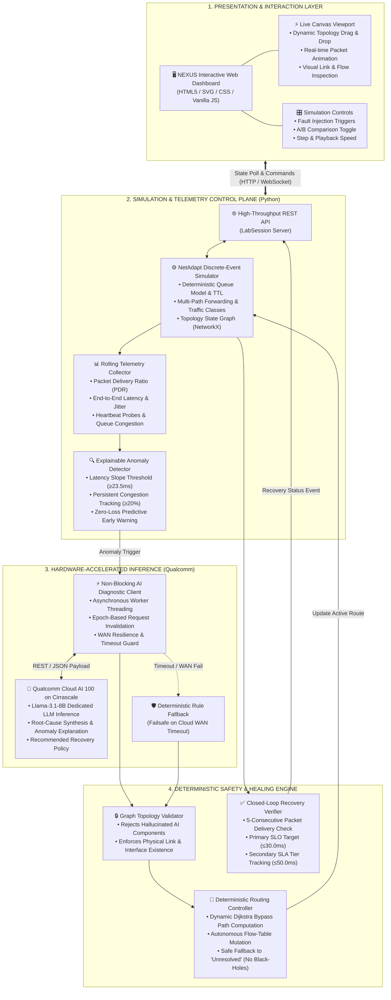
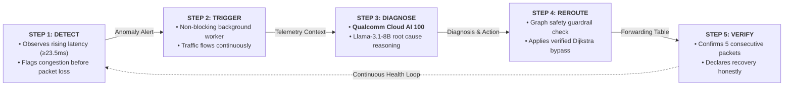

# NEXUS: AI-Assisted Self-Healing Network Simulator
> **Track:** NC-04: Self-Healing Network Simulator | **Technology:** Qualcomm Cloud AI 100 Playground  
> **Team:** Team Setu (Bhoj Reddy Engineering College for Women, Hyderabad)  
> **Event:** HACK-AI-THON 2026 / ENG NEXT 2026 (Infosys & Qualcomm)

---

## 📌 Executive Summary

**NEXUS** is an autonomous, closed-loop network simulation and self-healing platform. It combines a high-fidelity discrete-event packet simulation engine with hardware-accelerated **Qualcomm Cloud AI 100** inference (running Llama-3.1-8B on Cirrascale) to detect network degradation, explain root causes from live telemetry, dynamically reroute traffic, and strictly verify recovery before declaring success.

Unlike conventional reactive routing protocols or brittle automation scripts, NEXUS:
1. **Predicts degradation before service impact**: Detects subtle congestion slope and queue latency at ~24 ms, rerouting before breaching the 30.0 ms SLO.
2. **Operates asynchronously without packet stalling**: Simulation and packet forwarding run at wire speed; AI queries dispatch non-blockingly with epoch invalidation.
3. **Enforces deterministic graph safety guardrails**: AI suggestions are verified against physical NetworkX topology—hallucinated components are rejected.
4. **Validates recovery with closed-loop evidence**: A recovery is declared only after 5 consecutive packets are verified on the replacement route. If all alternative paths are severed, the system honestly reports an **Unresolved** outcome rather than claiming false success.

---

## 🏛️ System Architecture



---

## 🔄 End-to-End Self-Healing Workflow



1. **Step 1: Detect (Explainable Telemetry)**: The `ExplainableDetector` evaluates rolling delivery rates, jitter, queue depths, and heartbeat probes. In `mild_congestion`, it flags early warnings when path latency approaches 23.5 ms or edge congestion reaches 20%.
2. **Step 2: Trigger (Asynchronous Dispatch)**: When an anomaly is confirmed, a new AI epoch is spawned. The simulator continues processing live packets without waiting or dropping frames.
3. **Step 3: Diagnose (Qualcomm Cloud AI 100)**: The telemetry summary is formatted into a prompt and submitted to **Llama-3.1-8B on Cirrascale**. The LLM infers the root cause (e.g. `HIGH_CONGESTION` or `LINK_FAILURE`), identifies the degraded link (`R2-R4`), and recommends an action (`REROUTE_TRAFFIC`).
4. **Step 4: Reroute (Deterministic Safety Guardrails)**: The engine validates that the proposed component exists in the live NetworkX topology graph. Hallucinations or malformed responses fall back safely to deterministic rules. The engine computes the optimal bypass route (e.g., `Client ➔ R1 ➔ R3 ➔ R5 ➔ R6 ➔ Server`) and updates forwarding tables.
5. **Step 5: Verify (Closed-Loop Proof)**: The healing manager watches packets traversing the new route. Recovery is only certified once **5 consecutive packets** are delivered successfully. Latency is compared against:
   * **Primary SLO**: ≤ 30.0 ms
   * **Secondary SLA Tier**: ≤ 50.0 ms

---

## 🚀 Key Features

* **Live Qualcomm Cloud AI 100 Integration**: Native REST integration with Cirrascale playground endpoints running Llama-3.1-8B with markdown-tolerant regex parsing and automated epoch invalidation.
* **Pre-Impact Proactive Healing**: Tested against mild congestion where route switching occurs at 24.0 ms, prior to unmitigated queue delay crossing the 30.0 ms service target.
* **Dynamic Manual Editing**: Add, delete, reconnect, shutdown, or modify routers and links mid-simulation. Dynamic topology events automatically trigger route checks or safely transition to unresolved states.
* **A/B Repeatable Benchmark Runner**: Side-by-side comparative evaluation of **Auto-Heal ON** vs **Auto-Heal OFF** under identical random seeds and workloads.
* **Judge-Facing Transparency Ribbon**: Displays real-time context tags:
  * `Failed: <component>`
  * `Prev: <old_route>` (strikethrough)
  * `Bypass: <new_route>`
  * `AI: Qualcomm Cloud AI 100 (<cause> · <evidence>)`
  * `✔ Delivery Restored · SLO Met / Secondary SLA Tier`

---

## 🛠️ Tech Stack

* **Backend**: Python 3.12, NetworkX, discrete-event packet simulation engine, pytest
* **Frontend**: HTML5, Vanilla JavaScript (ES6+), SVG Canvas, CSS Grid/Flexbox
* **AI & Acceleration**: Qualcomm Cloud AI 100 on Cirrascale, Meta Llama-3.1-8B
* **Integrations**: Optional one-way Telegram alerting worker

---

## 💻 Quick Start & Running Locally

### Prerequisites
* Python 3.10+
* Git

### Installation
```bash
# Clone the repository
git clone https://github.com/Reya-Doshi/Nexus.git
cd Nexus

# Create and activate virtual environment
python -m venv .venv
.\.venv\Scripts\activate   # Windows
# source .venv/bin/activate # Linux/macOS

# Install dependencies
pip install -r python-tested-requirements.txt
```

### Configure Qualcomm Cloud AI Credentials
Create a `.env` file in the project root:
```env
QUALCOMM_AI_API_KEY=your_qualcomm_api_key_here
QUALCOMM_AI_ENDPOINT=https://playground.qualcomm.com/api/v1/chat/completions
QUALCOMM_AI_MODEL=Llama-3.1-8B
```
*(If credentials are not supplied or network fails, the system automatically runs deterministic rule fallback.)*

### Launch the Application
```bash
# Start the lab server
python -m netadapt.lab_server --port 8000
```
Open your browser and navigate to:  
👉 **`http://localhost:8000/`**

---

## 🧪 Automated Testing & Verification

The test suite validates packet delivery, Dijkstra path calculations, detection rules, recovery criteria, manual edits, and comparison benchmarks:
```bash
pytest netadapt/test_reroute.py -v
```

---

## 👥 Team Information

* **Team:** Team Setu
* **College:** Bhoj Reddy Engineering College for Women, Hyderabad
* **Members:**
  * Reya Doshi (Team Lead)
  * D. Swathi
  * Amula Pranathi
